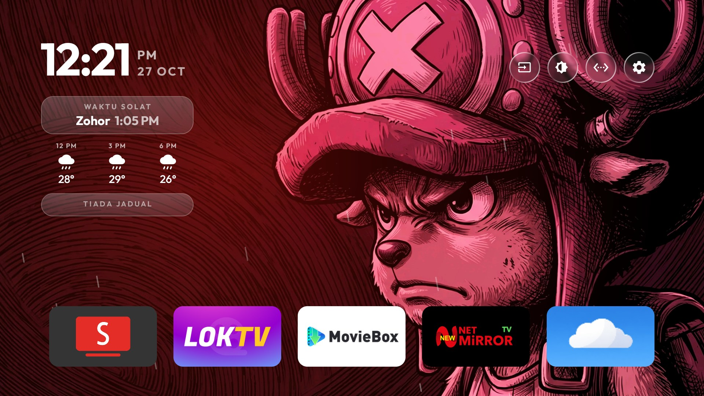
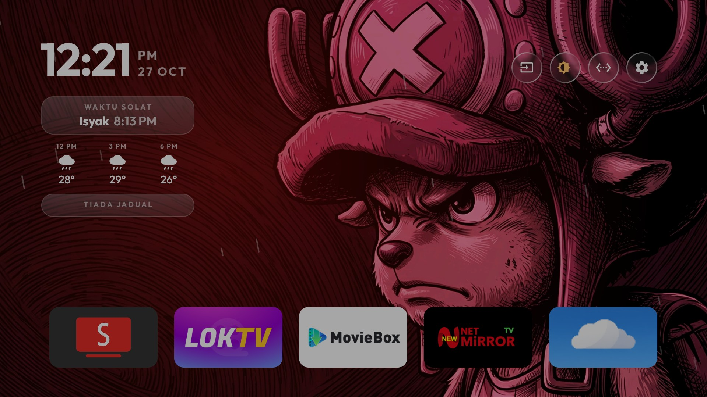

# Glass TV — Malaysian Edition


Home screen replacement untuk **Android TV**, dibina untuk ruang tamu Malaysia:
waktu solat yang berputar, peringatan azan, cuaca +3j/+6j, hujan atas wallpaper bila
luar hujan, kotak jadual yang tak hilang, dan wallpaper yang bertukar dengan
animasi dissolve.



<p align="center"><sub>Kotak solat · cuaca · jadual · dock apps · wallpaper penuh</sub></p>

---

## Isi kandungan

- [Pemasangan pantas](#pemasangan-pantas)
- [Screenshot](#screenshot)
- [Ciri-ciri](#ciri-ciri)
- [Konfigurasi](#konfigurasi)
- [Nota teknikal TV](#nota-teknikal-tv)
- [Sejarah build](#sejarah-build)
- [Privasi](#privasi)
- [Kredit & lisenn](#kredit--lisenn)

---

## Pemasangan pantas

APK siap ada dalam folder [`apk/`](apk/):

```bash
adb connect <ip-tv>:5555
adb install -r apk/GlassTV-v8-dim35-overlay.apk
adb shell appops set com.gathin.tvhome SYSTEM_ALERT_WINDOW allow   # untuk butang Dim
adb shell am start -n com.gathin.tvhome/.MainActivity
```

Kemudian push theme (waktu solat, lokasi cuaca, wallpaper):

```bash
TV_HOST=<ip-tv> tools/theme.sh themes/mitv-mooq0        # macOS / Linux
tools\theme.ps1 themes\mitv-mooq0                        # Windows
```

> APK ini **release build** dan ditandatangani dengan **debug key** — sesuai untuk
> sideload pada TV sendiri, bukan untuk Play Store. Theme tidak disertakan dalam APK:
> koordinat, alamat kalendar dan wallpaper di-push berasingan ke TV sahaja.

---

## Screenshot

| Biasa | Butang Dim ON (35%) |
|---|---|
|  |  |

---

## Ciri-ciri

| | Ciri | Ringkas |
|---|---|---|
| 🕌 | **Waktu Solat** | JAKIM e-Solat, 5 waktu berputar setiap 4.2 s, waktu semasa disorot emas, cache offline |
| 🔊 | **Azan** | Banner + bunyi dipotong ikut `azan_seconds`, notifikasi pada channel `azan` |
| 🌤 | **Cuaca** | Open-Meteo: sekarang / +3j / +6j, refresh setiap 30 min |
| 🌧 | **Hujan atas wallpaper** | Gerimis, hujan, ribut + kilat, salji — ikut kod cuaca WMO |
| 📅 | **Jadual** | iCal, kotak kekal dengan `TIADA JADUAL` bila kosong |
| 🖼 | **Wallpaper dissolve** | Tukar bila fokus bergerak, fade 500/900 ms, ada queue |
| ☀️ | **Dim 35%** | Overlay atas **semua app**, bukan Home sahaja |
| 🧹 | **Self-clean cache** | Setiap 15 hari, automatik |
| 🧩 | **Dock & susunan** | 5 kolum, dock carousel, apps tersembunyi tanpa uninstall |
| 🔓 | **Debloat boleh undo** | `pm disable-user` sahaja, `tools/restore.sh` balikkan semula |

### 1. Waktu Solat — lima waktu berputar

- Waktu dari **JAKIM e-Solat** (`e-solat.gov.my`), zone `PNG01`, diambil sekali sehari
  dan di-cache — kotak tetap tunjuk waktu hari ini walaupun TV offline.
- Kotak **berputar melalui 5 waktu setiap 4.2 s** — Subuh, Zohor, Asar, Maghrib, Isyak —
  jadi semua waktu boleh dibaca tanpa tekan apa-apa.
- Waktu yang **sedang berjalan** dipaparkan warna emas dengan rim menyala.
- Caption `Waktu Solat` bila data hari ini; nama zone bila dari cache.
- Tarikh Hijri di sebelah jam.

### 2. Azan

Bila masuk waktu: banner naik (`Azan <waktu>` + jam + zone), bunyi azan dimainkan
**sekadar beberapa saat** kemudian dipotong, dan notifikasi keluar di channel `azan`.

```json
"azan": true,
"azan_seconds": 15
```

`azan_seconds`: `5` = peringatan pendek, `15` = nilai di TV ini, `0` = main penuh.

### 3. Cuaca

- **Open-Meteo** — percuma, tanpa API key: `temperature_2m` + `weather_code`, setiap jam, 2 hari.
- Tiga lajur: **jam sekarang**, **+3 jam**, **+6 jam**; ditulis semula bila masuk jam baru.
- Ikon ikut bentuk Google Weather.
- Fetch setiap 30 minit di thread latar; gagal → cuba lagi 15 minit, kekalkan cache.

### 4. Hujan atas wallpaper

| Kod WMO | Babak | Titis |
|---|---|---|
| 51–57 | gerimis | 40 |
| 61–67, 80–82 | hujan | 80 |
| 95+ | ribut (hujan + kilat) | 104 |
| 71–77, 85–86 | salji | 54 |

Titis ialah garis pendek senget, satu loop **30 fps**, hanya dilukis bila Home di depan.
`"reduced_motion": true` mengurangkan separuh bilangan titis.

### 5. Jadual (kalendar)

- Baca **feed iCalendar** (alamat "secret iCal" Google Calendar, atau mana-mana `.ics`),
  gabung, papar beberapa event seterusnya dengan masa dan tajuk.
- Bila kosong: kotak **kekal**, caption jadi **`TIADA JADUAL`** — layout tak lompat.
- 🔒 Alamat feed ialah rahsia peribadi: ia hanya ada dalam tetapan TV, **tiada** dalam repo.

### 6. Wallpaper dissolve

- Dua sumber: gambar **Places** (foto halaman utama Bing setiap minggu, dengan nama tempat
  dan negara) dan **gambar sendiri** dalam
  `/sdcard/Android/data/com.gathin.tvhome/files/wallpapers/`.
- Bertukar **bila fokus bergerak** antara app, dengan **dissolve sebenar** — gambar baru
  muncul di belakang, gambar lama pudar 500 ms (`reduced_motion`) atau 900 ms.
- Permintaan tukar semasa dissolve sedang berjalan akan **diqueue**, jadi tekan remote
  laju-laju pun tetap berakhir dengan gambar baru.
- `"places": false` = sepenuhnya offline, guna gambar sendiri sahaja.

### 7. Dim 35% — atas semua app

Butang matahari di sebelah **Input**, gelapkan seluruh skrin **35%** dengan lapisan
dalam tetingkap sendiri (`APPLICATION_OVERLAY`), jadi ia meliputi **YouTube dan app lain**,
bukan Home sahaja.

- 35% dipilih selepas 25% tak nampak beza: putih `255` → `166`.
- Tetingkap tak ambil fokus dan tak ambil sentuhan — remote terus berfungsi.
- Keadaan diingati selepas restart.
- TV ini **abaikan tetapan kecerahan Android** — sebab itu lapisan digunakan
  (lihat [`docs/TV-QUIRKS.md`](docs/TV-QUIRKS.md)).

### 8. Self-clean cache

Glass TV bersihkan cache app lain **setiap 15 hari** secara automatik (`TvHome.Clean`
dalam logcat). Perlu pengesahan "Allow USB debugging?" sekali di TV dan network debugging
kekal hidup; matikan debugging → hanya pembersihan berhenti, lain-lain tak berubah.

### 9. Dock & susunan

- `"columns": 5`, `"rows_below_dock": 0` — 5 app sebaris, tiada baris bawah dock.
- `"dock_carousel": true` — dock satu bar panjang yang berulang.
- `"dock_apps"` isi dock; lebih daripada muatan dock akan jadi baris grid pertama.
- `"hidden_apps"` sembunyikan pakej tanpa uninstall.
- Pemilik masih boleh susun app di TV (tahan OK → Move); susunan mereka mengatasi config.

### 10. Debloat, boleh undo

Pakej stok Xiaomi/MediaTek **dimatikan**, bukan di-uninstall:

```text
com.xiaomi.mitv.mediaexplorer   (file browser stok)
com.xiaomi.mitv.smartshare      (Miracast — dimatikan selepas disahkan tak digunakan)
com.mitv.tvhome.mitvplus        (tambahan PatchWall)
com.mitv.gallery                (galeri stok)
com.mediatek.wwtv.tvcenter      (app factory / menu ujian)
```

Semua perubahan dicatat, dan `tools/restore.sh` memulihkan TV: enable balik pakej,
enable balik launcher stok dan jadikan ia Home.

---

## Konfigurasi

Salin [`config.example.json`](config.example.json) → `config.json` dalam folder theme,
tukar `"<lat>,<lon>"` kepada lokasi anda.

| Kunci | Nilai | Makna |
|---|---|---|
| `prayer_zone` | `"PNG01"` | Zone JAKIM; kosong = sembunyi kotak solat |
| `azan` | `true` | Peringatan azan |
| `azan_seconds` | `15` | Saat bunyi azan dimainkan (`0` = penuh) |
| `weather_location` | `"<lat>,<lon>"` | Lokasi cuaca — **jangan commit** nilai sebenar |
| `weather_effect` | `true` | Hujan/salji atas wallpaper |
| `columns` | `5` | App sebaris |
| `rows_below_dock` | `0` | Baris bawah dock |
| `dock_carousel` | `true` | Dock berulang |
| `dock_apps` | `[ ... ]` | Pakej dalam dock |
| `hidden_apps` | `[ ... ]` | Pakej disembunyikan |
| `wallpaper` | `true` | Wallpaper hidup |
| `places` | `false` | `false` = offline, guna gambar sendiri |
| `wallpaper_seconds` | `15` | Selang tukar wallpaper |
| `reduced_motion` | `true` | Animasi pendek, separuh titis hujan |

Zone JAKIM ikut negeri/daerah: contoh `PNG01` (Putrajaya), `SGR01` (Selangor),
`WLY01` (KL), `JHR01` (Johor). Senarai penuh di laman e-Solat.

---

## Nota teknikal TV

Perkara yang TV ini buat lain daripada biasa — dan perangkap yang kena elak —
ada dalam [`docs/TV-QUIRKS.md`](docs/TV-QUIRKS.md):

- Panel **abaikan** `screen_brightness` (sebab Dim guna overlay, bukan kecerahan)
- Semua `*_animation_scale` = `0.0` (sebab dissolve guna `Handler` 33 ms, bukan animator)
- `screencap` **tangkap** overlay (berguna untuk uji), tapi tak tangkap kecerahan panel
- Mic **tak dikongsi** dengan app lain (`RECORD_AUDIO` granted tapi tiada input device)
- Gemini untuk TV perlu Android TV OS 14+; launcher tak boleh rampas intent `ASSIST`
- MediaTek: guna `screencap` + `pull`, bukan `exec-out screencap`

---

## Sejarah build

Setiap build dan sebab perubahan: [`CHANGELOG.md`](CHANGELOG.md).

| Versi | Saiz | Perubahan |
|---|---|---|
| v8 | 340,637 | Dim 35% (overlay) — **semasa** |
| v7 | 340,633 | Dim guna overlay, bukan kecerahan |
| v6 | 340,601 | Cubaan Dim guna `screen_brightness` (tak jalan) |
| v5 | 339,049 | Dissolve guna `Handler`, tambah queue |
| v4 | 338,793 | Buang tray kaca + caption nama app |
| v3 | 338,917 | `TIADA JADUAL`, wallpaper ikut fokus |

---

## Privasi

Repo ini **tiada**:

- alamat feed kalendar (secret iCal)
- koordinat rumah (hanya placeholder `<lat>,<lon>`)
- IP TV atau nama Wi-Fi
- akaun Google, maklumat Play Store, sejarah tontonan
- screenshot yang memaparkan event kalendar atau senarai app

Screenshot di sini diambil ketika kalendar kosong — yang keluar hanya `TIADA JADUAL`.
Sebelum tambah screenshot sendiri: `adb shell screencap -p /sdcard/home.png`, tarik keluar,
dan periksa dulu.

---

## Kredit & lisenn

Projek asal: [Clean Your TV / Glass TV](https://github.com/Gathin23/cleanyourtv) oleh
**Gathin** — [MIT](LICENSE). Font dalam APK: lihat [FONT-LICENSE-OFL.txt](FONT-LICENSE-OFL.txt).

Waktu solat: **JAKIM e-Solat** · Cuaca: **Open-Meteo** · Gambar Places: **Bing**.

Bukan projek rasmi Google/Xiaomi/JAKIM. Guna pada risiko sendiri.
