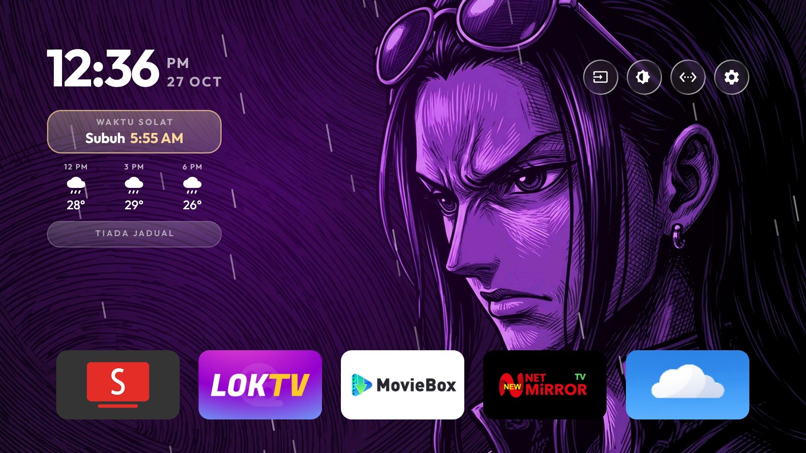
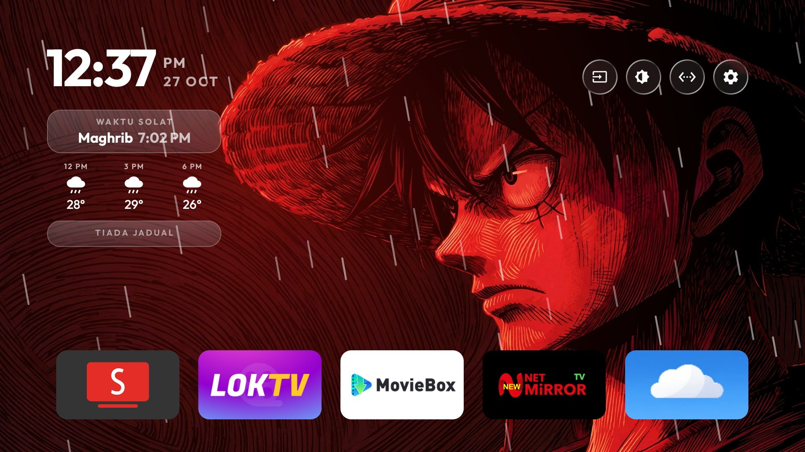
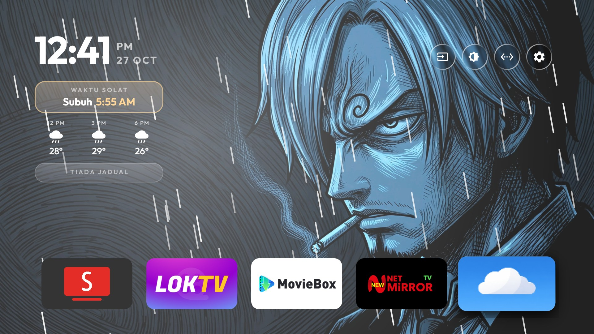
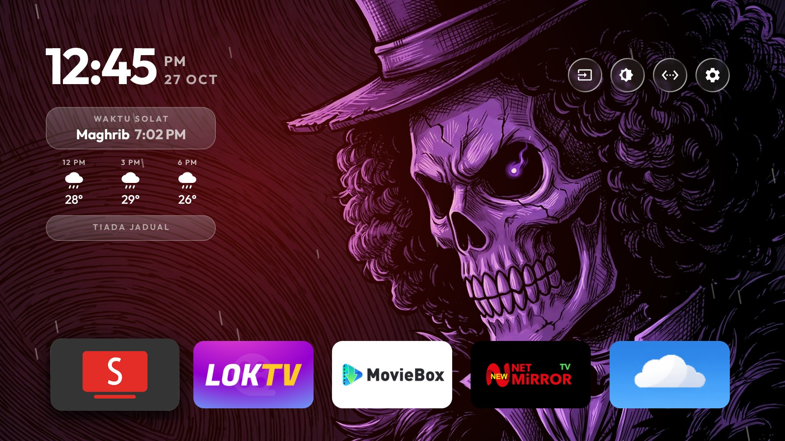
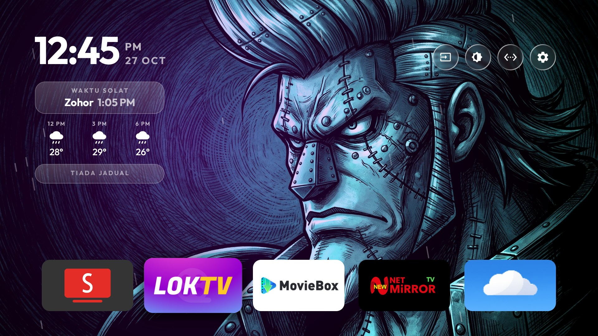
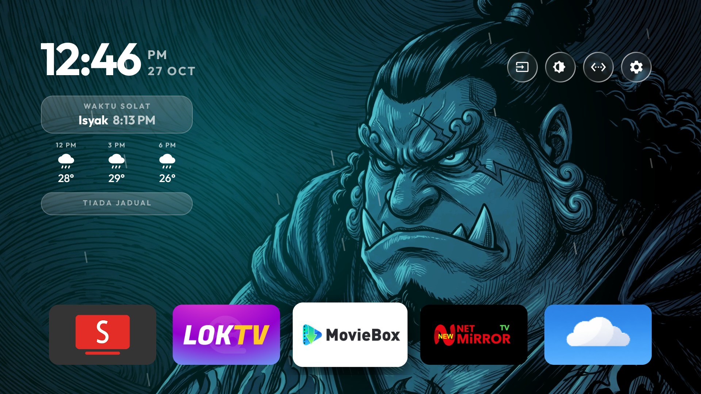

# Glass TV — Malaysian Edition

<p align="center"><a href="assets/donation-support.jpg"></a></p>


Home screen replacement untuk **Android TV**, dibina untuk ruang tamu Malaysia:
waktu solat yang berputar, peringatan azan, cuaca +3j/+6j, hujan atas wallpaper bila
luar hujan, kotak jadual yang tak hilang, dan **satu baris app carousel** yang berulang
tanpa hujung dengan wallpaper yang bertukar secara dissolve.


<p align="center"><sub>Kotak solat · cuaca · jadual · baris app carousel · wallpaper penuh</sub></p>

---

## Isi kandungan

- [Pemasangan pantas](#pemasangan-pantas)
- [Screenshot](#screenshot)
- [Ciri-ciri](#ciri-ciri)
- [Konfigurasi](#konfigurasi)
- [Nota teknikal TV](#nota-teknikal-tv)
- [Sejarah build](#sejarah-build)
- [Privasi](#privasi)
- [Kredit & lisenn](#kredit--lisenn)

---

## Pemasangan pantas

APK terbaru: [`apk/GlassTV-v38.apk`](apk/GlassTV-v38.apk) (rujuk juga folder [`apk/`](apk/) untuk versi lain).

```bash
adb connect <ip-tv>:5555
adb install -r apk/GlassTV-v10-carousel.apk
adb shell appops set com.gathin.tvhome SYSTEM_ALERT_WINDOW allow   # untuk butang Dim
adb shell am start -n com.gathin.tvhome/.MainActivity
```

Kemudian push theme (waktu solat, lokasi cuaca, wallpaper):

```bash
TV_HOST=<ip-tv> tools/theme.sh themes/mitv-mooq0        # macOS / Linux
tools\theme.ps1 themes\mitv-mooq0                        # Windows
```

> APK ini **release build** dan ditandatangani dengan **debug key** — sesuai untuk
> sideload pada TV sendiri, bukan untuk Play Store. Theme tidak disertakan dalam APK:
> koordinat, alamat kalendar dan wallpaper di-push berasingan ke TV sahaja.

---

## Screenshot

| Biasa | Butang Dim ON (35%) |
|---|---|
|  |  |

Baris app: app yang dipilih di tengah **120 %**, jiran 105 %, 95 %, 85 % dan hujungnya
pudar ke wallpaper — baris berulang, jadi app terakhir hanya satu langkah dari app pertama.

### Hujan atas wallpaper

Tiga aras, ikut kod cuaca WMO semasa — bukan gambar tetap, titis betul-betul bergerak
(satu loop 30 fps, berhenti bila app lain di depan).

| Hujan biasa (61–63, 80–81) | Hujan lebat (65, 82) | Ribut + kilat (95+) |
|---|---|---|
|  |  |  |

Hujan lebat = titis lebih banyak, lebih panjang dan lebih laju. Ribut tambah **kilat dua
kali** (alpha 52 → 34) setiap 4–12 s; gambar di atas tertangkap ketika kilat menyala.

### Wallpaper bertukar

Fokus bergerak → wallpaper dissolve ke gambar seterusnya (500 ms dengan
`reduced_motion`, 900 ms tanpa). Tiga gambar di bawah diambil dengan menekan D-pad
sahaja, tiada app dibuka:

| 1 | 2 | 3 |
|---|---|---|
|  |  |  |

---

## Ciri-ciri

| | Ciri | Ringkas |
|---|---|---|
| 🕌 | **Waktu Solat** | JAKIM e-Solat, 5 waktu berputar setiap 4.2 s, waktu semasa disorot emas, cache offline |
| 🔊 | **Azan** | Banner + bunyi dipotong ikut `azan_seconds`, notifikasi pada channel `azan` |
| 🌤 | **Cuaca** | Open-Meteo: sekarang / +3j / +6j, refresh setiap 30 min |
| 🌧 | **Hujan atas wallpaper** | Gerimis, hujan, **hujan lebat**, ribut + kilat, salji — ikut kod cuaca WMO |
| 📅 | **Jadual** | iCal, kotak kekal dengan `TIADA JADUAL` bila kosong |
| 🖼 | **Wallpaper dissolve** | Tukar bila fokus bergerak, fade 500/900 ms, ada queue |
| ☀️ | **Dim 35%** | Overlay atas **semua app**, bukan Home sahaja |
| 🧹 | **Self-clean cache** | Setiap 15 hari, automatik |
| 🎠 | **Carousel satu baris** | App di tengah 120 %, hujung pudar, berulang, boleh susun semula |
| 🧩 | **Dock & susunan** | 5 kolum, `dock_apps`, apps tersembunyi tanpa uninstall |
| 🔓 | **Debloat boleh undo** | `pm disable-user` sahaja, `tools/restore.sh` balikkan semula |

### 1. Waktu Solat — lima waktu berputar

- Waktu dari **JAKIM e-Solat** (`e-solat.gov.my`), zone `PNG01`, diambil sekali sehari
  dan di-cache — kotak tetap tunjuk waktu hari ini walaupun TV offline.
- Kotak **berputar melalui 5 waktu setiap 4.2 s** — Subuh, Zohor, Asar, Maghrib, Isyak —
  jadi semua waktu boleh dibaca tanpa tekan apa-apa.
- Waktu yang **sedang berjalan** dipaparkan warna emas dengan rim menyala.
- Caption `Waktu Solat` bila data hari ini; nama zone bila dari cache.
- Tarikh Hijri di sebelah jam.

### 2. Azan

Bila masuk waktu: banner naik (`Azan <waktu>` + jam + zone), bunyi azan dimainkan
**sekadar beberapa saat** kemudian dipotong, dan notifikasi keluar di channel `azan`.

```json
"azan": true,
"azan_seconds": 15
```

`azan_seconds`: `5` = peringatan pendek, `15` = nilai di TV ini, `0` = main penuh.

### 3. Cuaca

- **Open-Meteo** — percuma, tanpa API key: `temperature_2m` + `weather_code`, setiap jam, 2 hari.
- Tiga lajur: **jam sekarang**, **+3 jam**, **+6 jam**; ditulis semula bila masuk jam baru.
- Ikon ikut bentuk Google Weather.
- Fetch setiap 30 minit di thread latar; gagal → cuba lagi 15 minit, kekalkan cache.

### 4. Hujan atas wallpaper

| Kod WMO | Babak | Titis | Rupa |
|---|---|---|---|
| 51–57 | gerimis | 40 | pendek, perlahan, hampir lurus |
| 61–63, 66, 80–81 | hujan | 80 | sederhana, senget sedikit |
| 65, 67, 82 | **hujan lebat** | 128 | panjang, laju, lebih tebal |
| 95–99 | ribut | 160 | paling lebat + kilat |
| 71–77, 85–86 | salji | 54 | bulat, turun perlahan |

Titis ialah garis pendek senget, satu loop **30 fps**, hanya dilukis bila Home di depan.
`"reduced_motion": true` mengurangkan separuh bilangan titis (TV 1 GB RAM).

Nak tengok rupa satu babak tanpa tunggu cuaca betul-betul jadi begitu (untuk screenshot
atau uji theme):

```json
"weather_preview": "heavy"
```

Nilai: `"drizzle"`, `"rain"`, `"heavy"`, `"storm"`, `"snow"`. Biarkan kosong/tak letak
untuk ikut cuaca sebenar; nilai lain diabaikan.

### 5. Jadual (kalendar)

- Baca **feed iCalendar** (alamat "secret iCal" Google Calendar, atau mana-mana `.ics`),
  gabung, papar beberapa event seterusnya dengan masa dan tajuk.
- Bila kosong: kotak **kekal**, caption jadi **`TIADA JADUAL`** — layout tak lompat.
- Kotak ini juga kekal dalam mod carousel: tiada baris bawah yang melaluinya.
- 🔒 Alamat feed ialah rahsia peribadi: ia hanya ada dalam tetapan TV, **tiada** dalam repo.

### 6. Wallpaper dissolve

- Dua sumber: gambar **Places** (foto halaman utama Bing setiap minggu, dengan nama tempat
  dan negara) dan **gambar sendiri** dalam
  `/sdcard/Android/data/com.gathin.tvhome/files/wallpapers/`.
- Bertukar **bila fokus bergerak** antara app, dengan **dissolve sebenar** — gambar baru
  muncul di belakang, gambar lama pudar 500 ms (`reduced_motion`) atau 900 ms.
- Permintaan tukar semasa dissolve sedang berjalan akan **diqueue**, jadi tekan remote
  laju-laju pun tetap berakhir dengan gambar baru.
- `"places": false` = sepenuhnya offline, guna gambar sendiri sahaja.

### 7. Dim 35% — atas semua app

Butang matahari di sebelah **Input**, gelapkan seluruh skrin **35%** dengan lapisan
dalam tetingkap sendiri (`APPLICATION_OVERLAY`), jadi ia meliputi **YouTube dan app lain**,
bukan Home sahaja.

- 35% dipilih selepas 25% tak nampak beza: putih `255` → `166`.
- Tetingkap tak ambil fokus dan tak ambil sentuhan — remote terus berfungsi.
- Keadaan diingati selepas restart.
- TV ini **abaikan tetapan kecerahan Android** — sebab itu lapisan digunakan
  (lihat [`docs/TV-QUIRKS.md`](docs/TV-QUIRKS.md)).

### 8. Self-clean cache

Glass TV bersihkan cache app lain **setiap 15 hari** secara automatik (`TvHome.Clean`
dalam logcat). Perlu pengesahan "Allow USB debugging?" sekali di TV dan network debugging
kekal hidup; matikan debugging → hanya pembersihan berhenti, lain-lain tak berubah.

### 9. Dock & susunan

- `"columns": 5`, `"rows_below_dock": 0` — satu baris app, tiada baris bawah.
- `"dock_carousel": true` — baris itu jadi **carousel berulang**: app yang dipilih di tengah
  (120 %), jiran 105 % / 95 % / 85 %, app tengah naik sedikit (lengkung lembut), dan dua hujung
  baris **pudar ke wallpaper** — bukan terpotong.
- Baris duduk di **bawah skrin** dan tak bergerak naik-turun walaupun jam atau kotak jadual
  bertukar tinggi.
- Langkah sentiasa **satu slot**: app terakhir → app pertama hanya satu slide pendek, bukan
  pusing balik seluruh baris (senarai diulang 201 kali; 0 px offset di tengah setiap langkah).
- Tiada panel kaca dan tiada caption nama app di belakang app yang dipilih — saiznya yang
  jadi penanda.
- `"dock_apps"` isi susunan awal; `"hidden_apps"` sembunyikan pakej tanpa uninstall.
- **Susun semula di TV**: tahan OK → `Move`, kemudian ◀ ▶ untuk alih app satu tempat, OK untuk
  letak. Susunan disimpan dan mengatasi `dock_apps`. Ia berhenti di app pertama dan terakhir.

### 10. Debloat, boleh undo

Pakej stok Xiaomi/MediaTek **dimatikan**, bukan di-uninstall:

```text
com.xiaomi.mitv.mediaexplorer   (file browser stok)
com.xiaomi.mitv.smartshare      (Miracast — dimatikan selepas disahkan tak digunakan)
com.mitv.tvhome.mitvplus        (tambahan PatchWall)
com.mitv.gallery                (galeri stok)
com.mediatek.wwtv.tvcenter      (app factory / menu ujian)
```

Semua perubahan dicatat, dan `tools/restore.sh` memulihkan TV: enable balik pakej,
enable balik launcher stok dan jadikan ia Home.

### 11. Double press Back untuk clear cache & memori

Di **Homepage**, tekan **Back dua kali** dalam masa singkat untuk bersihkan cache aplikasi dan memori sistem. Kawalan ringkas, minimal dan kemas untuk kekalkan TV laju.

---

## Konfigurasi

Salin [`config.example.json`](config.example.json) → `config.json` dalam folder theme,
tukar `"<lat>,<lon>"` kepada lokasi anda.

| Kunci | Nilai | Makna |
|---|---|---|
| `prayer_zone` | `"PNG01"` | Zone JAKIM; kosong = sembunyi kotak solat |
| `azan` | `true` | Peringatan azan |
| `azan_seconds` | `15` | Saat bunyi azan dimainkan (`0` = penuh) |
| `weather_location` | `"<lat>,<lon>"` | Lokasi cuaca — **jangan commit** nilai sebenar |
| `weather_effect` | `true` | Hujan/salji atas wallpaper |
| `weather_preview` | `"heavy"` | Paksa satu babak cuaca (uji/screenshot); kosong = ikut cuaca sebenar |
| `columns` | `5` | App sebaris |
| `rows_below_dock` | `0` | Baris bawah dock |
| `dock_carousel` | `true` | Dock berulang |
| `dock_apps` | `[ ... ]` | Pakej dalam dock |
| `hidden_apps` | `[ ... ]` | Pakej disembunyikan |
| `wallpaper` | `true` | Wallpaper hidup |
| `places` | `false` | `false` = offline, guna gambar sendiri |
| `wallpaper_seconds` | `15` | Selang tukar wallpaper |
| `reduced_motion` | `true` | Animasi pendek, separuh titis hujan |

Zone JAKIM ikut negeri/daerah: contoh `PNG01` (Putrajaya), `SGR01` (Selangor),
`WLY01` (KL), `JHR01` (Johor). Senarai penuh di laman e-Solat.

---

## Nota teknikal TV

Perkara yang TV ini buat lain daripada biasa — dan perangkap yang kena elak —
ada dalam [`docs/TV-QUIRKS.md`](docs/TV-QUIRKS.md):

- Panel **abaikan** `screen_brightness` (sebab Dim guna overlay, bukan kecerahan)
- Semua `*_animation_scale` = `0.0` (sebab dissolve guna `Handler` 33 ms, bukan animator)
- `screencap` **tangkap** overlay (berguna untuk uji), tapi tak tangkap kecerahan panel
- Mic **tak dikongsi** dengan app lain (`RECORD_AUDIO` granted tapi tiada input device)
- Gemini untuk TV perlu Android TV OS 14+; launcher tak boleh rampas intent `ASSIST`
- MediaTek: guna `screencap` + `pull`, bukan `exec-out screencap`

---

## Sejarah build

Setiap build dan sebab perubahan: [`CHANGELOG.md`](CHANGELOG.md).

| Versi | Saiz | Perubahan |
|---|---|---|
| v10 | 343,129 | Satu baris carousel: tengah 120 %, hujung pudar, berulang, Move jalan — **semasa** |
| v9 | 341,037 | Hujan lebat jadi babak sendiri + `weather_preview` |
| v8 | 340,637 | Dim 35% (overlay) |
| v7 | 340,633 | Dim guna overlay, bukan kecerahan |
| v6 | 340,601 | Cubaan Dim guna `screen_brightness` (tak jalan) |
| v5 | 339,049 | Dissolve guna `Handler`, tambah queue |
| v4 | 338,793 | Buang tray kaca + caption nama app |
| v3 | 338,917 | `TIADA JADUAL`, wallpaper ikut fokus |

---

## Privasi

Repo ini **tiada**:

- alamat feed kalendar (secret iCal)
- koordinat rumah (hanya placeholder `<lat>,<lon>`)
- IP TV atau nama Wi-Fi
- akaun Google, maklumat Play Store, sejarah tontonan
- screenshot yang memaparkan event kalendar atau senarai app

Screenshot di sini diambil ketika kalendar kosong — yang keluar hanya `TIADA JADUAL`.
Wallpaper dalam screenshot ialah gambar peribadi pemilik TV, dimasukkan dengan izinnya.
Sebelum tambah screenshot sendiri: `adb shell screencap -p /sdcard/home.png`, tarik keluar,
dan periksa dulu.

---

## Kredit & lisenn

Projek asal: [Clean Your TV / Glass TV](https://github.com/Gathin23/cleanyourtv) oleh
**Gathin** — [MIT](LICENSE). Font dalam APK: lihat [FONT-LICENSE-OFL.txt](FONT-LICENSE-OFL.txt).

Waktu solat: **JAKIM e-Solat** · Cuaca: **Open-Meteo** · Gambar Places: **Bing**.

Bukan projek rasmi Google/Xiaomi/JAKIM. Guna pada risiko sendiri.
=======
# Glass TV

<p align="center"><a href="assets/donation-support.jpg"></a></p>


**Make your Android TV or Google TV fast and ad-free again: strip out the bloat and ads, free up memory,
and come home to just your apps, with a new place to visit behind them every week.**

Glass TV debloats any Android TV or Google TV over Wi-Fi, with no root and nothing that can't be undone, then
swaps the ad-filled home screen for a light one in frosted glass, with a new set of places behind your apps
every week.

<p>
  
  
  
</p>

## What you get

- **Keeps itself clean.** Every 15 days, while Home sits idle, the TV clears its app caches, where the Play
  Store leaves gigabytes of download leftovers that can make apps open to a blank screen. No computer needed,
  sign-ins and app data are never touched; the TV asks once to allow it.
- **Glass, like Apple's.** The dock's tray, the top-bar buttons and the menus show the picture behind them
  softened, with a shine along their edges. Android 10 has no live blur, so the picture is blurred once each
  time it changes and the glass draws its patch of it.
- **One selection that glides.** Between apps it is a pane of glass with the app's shadow under it; on the top
  bar and in the menus it is dark. It glides and changes shape from one to the next, never jumps.
- **Places to visit that renew themselves.** Once a week the TV takes the pictures Bing has shown on its home
  page over the past days — landmarks, landscapes, wildlife — deletes last week's and rotates through them,
  dimmed so the clock and tiles stay readable. The shelf above the dock names each one, its country and a few
  lines about it. Pictures with people in them are skipped: by the words in their caption, and by Android's
  own face detector on the TV. No key, no account, nothing to set up.
- **Every app tints the room.** The glow behind Home, and the glass with it, blends to the colour of whichever
  app is selected.
- **Arrange your apps from the remote.** Hold OK on an app for a glass menu: **Move**, **Hide from Home**,
  **Add apps** and **App info**. Move picks the app up: it wiggles, the arrows carry it (into or out of the
  dock too) and the other apps slide aside; OK puts it down. The order is kept, and apps installed later join
  at the end. Hide takes an app out of the row without uninstalling it — the row closes up where it was — and
  Add apps lists everything Home is not showing, so it can go back in the dock's last place. Both choices
  stay on the TV, so a theme push cannot undo them.
- **An Inputs menu in glass.** The selection glides out of the Inputs button into the list of HDMI and AV
  inputs, and Up from the top of the list glides it back.
- **Comes back as you left it.** Back from an app, the app you left is still selected; pressing Home on Home
  goes to the first app. When Android has closed Home to free memory, it comes back whole in one frame,
  with no black screen and no half-built dock.
- **A clock screensaver.** What Home is showing, darkened, behind a big digital clock: the date, and one line
  with the temperature, the weather and the next prayer. It drifts a few pixels every minute so nothing burns
  in, and any key brings the TV back. A theme can put the grey analog dial with its ticking second hand back
  (`"dream": {"dial": true}`), drop the picture or the extra line.
- **Rows feather out under the top bar** instead of being cut off when you scroll, and the Wi-Fi / Ethernet
  button can be hidden (`show_network_pill`).
- **Rotating wallpapers of your own** instead, with `"places": false`: put pictures in a theme's `wallpapers/`
  folder and choose how often they change, down to every 5 seconds. Each picture is decoded in the background
  and cross-faded.

| | |
|---|---|
|  |  |
| *Home, with this week's place* | *Every app, feathering out under the top bar* |
|  |  |
| *Inputs, in glass* | *The clock screensaver, over this week's place* |

Still light: on a Xiaomi Mi TV with 1.8 GB of RAM the launcher uses about 80–100 MB and stays there over hours
of use, one wallpaper is in memory at a time, the week's places take about 2 MB of storage, and nothing runs
while you are inside an app.

## Setting it up

**Using an AI coding agent** (Claude Code, Codex, Cursor, Copilot…)? Point it at this repository and ask it to
set up your TV. [AGENTS.md](AGENTS.md) tells any agent, even a small model, how to do it safely on any Android TV or Google
TV: it first works out which Glass TV your TV can run (the Android launcher, the LG webOS app, or neither on
Samsung and Roku), then
asks before each change, backs up first, never uninstalls, and checks each step with you as it goes.

The full step-by-step guide for debloating and installing is in
[docs/CLEANYOURTV-README.md](docs/CLEANYOURTV-README.md), and [PROMPT.md](PROMPT.md) lets a coding assistant do
it for you. In short:

```bash
python3 -m venv tools/venv && tools/venv/bin/pip install -r tools/requirements.txt
export TV_HOST=192.168.1.50                                   # your TV's IP address
tools/disable.sh examples/<your tv>/debloat.txt               # debloat
launcher/build-and-install.sh                                 # build the launcher and make it Home
tools/theme.sh themes/<your theme>                            # push your settings and wallpapers
```

Glass TV clears the TV's caches by itself every 15 days ([how](docs/cache-clean.md)). To clean several TVs
from one computer instead, [`tools/cache-clean.sh`](docs/cache-clean.md) finds the TVs on your network and
clears their caches, leaving sign-ins and app data untouched.

## Which TVs work

Android TV and Google TV, Android 8 or newer, on the TV or on a box plugged into any TV.
[docs/DEVICES.md](docs/DEVICES.md) lists every tested model and how far each was tested: end to end with
Glass TV, with the original launcher, or debloat only, plus what is expected to work and what cannot.

## LG and Samsung TVs

LG TVs run webOS and Samsung TVs run Tizen; neither can run Android apps, and neither lets any app replace its
home screen or the Home button. For the full Glass TV, plug in a Google TV or Android TV box (Chromecast with
Google TV, Xiaomi Mi Box, NVIDIA Shield): the TV becomes the screen and Glass TV is Home. On LG, a version you
open as an app is in preview in [webos/](webos/README.md). A Samsung version that comes back after Samsung's home is
planned: see [docs/ROADMAP.md](docs/ROADMAP.md).

## Places, or pictures of your own

Places are on from the start. To change how often the picture changes, or to use your own pictures and keep
the launcher offline, make a theme folder with a `config.json` like this and push it with `tools/theme.sh`:

```json
{
  "places": false,
  "wallpaper_seconds": 15,
  "show_network_pill": false
}
```

All keys are listed in [themes/README.md](themes/README.md). With `"places": false`, the launcher never goes
online.

## Credits and licence

- Built on [CleanYourTV](https://github.com/Gathin23/cleanyourtv) © 2026 Gathin, MIT licence — see
  [LICENSE](LICENSE). Its debloat lists, tools and launcher are the foundation of this project.
- The Figtree typeface is under the SIL Open Font License (`launcher/FONT-LICENSE-OFL.txt`).
- The Inputs icon is from Google's Material Icons (Apache 2.0).
- Pictures of places and their captions are Bing's daily images (Microsoft). The launcher fetches them on your
  own TV; the promo pictures above show three of them.
- Gotham, used in the promo pictures only, is a Hoefler&Co. typeface and is not part of this repository.
>>>>>>> d040e19 (Add support/donation banner)
